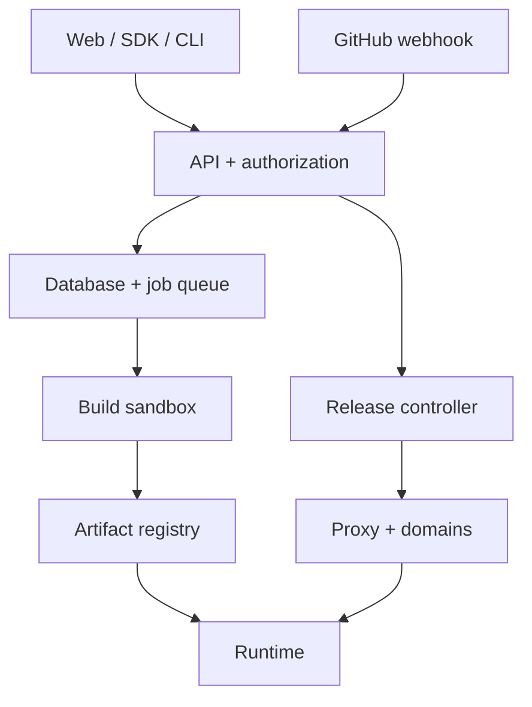

# Architecture Roadmap

หน้านี้สรุปข้อเสนอทางสถาปัตยกรรมสำหรับอนาคตของ ai-sdk.pro ไม่ใช่รายการของระบบที่ติดตั้งหรือเชื่อมต่อแล้ว เอกสารที่รันได้ใน repository ตอนนี้ครอบคลุม agent, chat endpoint, client SDK และการ self-host เว็บเอกสาร ส่วน control plane, build plane, runtime plane และ Git provider integration ยังต้องพัฒนาและเลือกโครงสร้างพื้นฐานจริงก่อนเปิดใช้

## แยก control, build และ runtime

ควรแบ่งระบบเป็นสามขอบเขต แม้ระยะแรกบาง service จะอยู่ VPS เดียวกันได้:

- **Control plane** เก็บบัญชี ทีม project สิทธิ์ quota และประวัติ deployment แต่ไม่รัน build script จาก repository ของผู้ใช้
- **Build plane** ดึง source ตาม commit ที่ล็อกไว้ ติดตั้ง dependency build test และสร้าง artifact โดยไม่ถือกุญแจบริหาร production ทั้งระบบ
- **Runtime plane** รัน artifact ที่ผ่านการตรวจ รับ traffic และ health check โดยแยก environment ของแต่ละ project

การแยกนี้เป็น security boundary ที่ต้องบังคับใช้ด้วยระบบ ไม่ใช่แค่ prompt ของ agent การรันโค้ดที่ไม่เชื่อถือยังต้องมี sandbox, quota, network policy และวิธีหยุด abuse ตามระดับบริการ



## Agent modes ที่ควรเริ่มจากข้อมูลจริง

เริ่มจาก controller เดียวที่ตรวจสอบได้ แล้วแยก mode ตามงานก่อนสร้างหลาย agent ที่คุยกันเอง ตัวอย่าง mode ที่เสนอคือ repository analyst, coding agent, build diagnostician, deployment assistant และ operations assistant

ทุก mode ควรกำหนด objective, context, tools, permissions, workspace boundary, step/time budget, stop conditions และหลักฐานผลลัพธ์ เช่น diff, test result, source commit, artifact digest หรือ deployment ID

```yaml
# Proposed policy shape; this is not an installed AI SDK configuration file.
id: build-assistant
version: 1
objective: diagnose_and_fix_build
context:
  source: immutable_commit_snapshot
tools:
  - repository.read
  - workspace.apply_patch
  - sandbox.run_build
  - sandbox.run_tests
limits:
  max_model_steps: 12
  max_fix_attempts: 2
permissions:
  repository_write: workspace_only
  production_promote: owner_policy
  secret_read: denied
  host_shell: denied
output:
  required: [diagnosis, changed_files, test_results, source_commit]
```

AI SDK tool approval ช่วยขอการยืนยันในบทสนทนาได้ แต่ไม่แทน authorization ของ backend ฝั่ง server ต้องตรวจว่าใครอนุมัติ action ใด และผูก approval กับ project, commit และ artifact ใด สำหรับงานนานควรเก็บสถานะในฐานข้อมูลและใช้ worker หรือ workflow runtime ที่รองรับ resume แทนการพึ่ง memory ของ request เดียว

## Git → preview → production

เส้นทางระยะยาวควรให้ผู้ใช้ติดตั้ง GitHub App เฉพาะ repository ที่เลือก จากนั้นเลือก branch และ root directory อ่าน configuration โดยยังไม่รันโค้ด ล็อก commit SHA ส่งงานเข้า queue, build ใน sandbox, เก็บ logs และ artifact แบบอ้างด้วย digest, เปิด preview health check แล้วจึง promote production ตาม policy

ต้องตรวจ HMAC จาก raw webhook body, กัน delivery ซ้ำด้วย delivery ID, ใช้ lease/heartbeat สำหรับ worker และไม่ส่ง production secret เข้า build ที่มาจาก fork การ rollback ควรชี้ไป artifact เดิมโดยไม่ build ใหม่เมื่อทำได้ และต้องแยก app rollback ออกจาก database migration rollback

GitHub App, database, queue, object storage, OCI registry และ sandbox เป็น dependencies ที่ต้องตั้งค่าและดูแลเองในอนาคต หน้านี้ไม่ได้อ้างว่า repository เชื่อมต่อ GitHub App, Coolify, registry หรือ VPS orchestration แล้ว

## Coolify และการเปิดบริการสาธารณะ

Coolify สามารถเป็น deployment adapter ระยะแรกสำหรับ repository ที่เชื่อถือได้ แต่ API token ที่มีสิทธิ์เขียนอาจเปิดความสามารถระดับ Compose หรือ host mount ได้ จึงไม่ควรถือว่า project permission ของ deployment engine เป็น sandbox สำหรับโค้ดสาธารณะ การเปิดรับโค้ดจากผู้ใช้ทั่วไปต้องเพิ่ม build/runtime isolation, quota, outbound policy, secret filtering และ abuse controls

ทางเลือกที่ชัดเจนคือเริ่มจาก **Bring Your Own VPS** สำหรับทีมที่ควบคุมเครื่องเอง แล้วค่อยเพิ่ม managed hosting เมื่อมีระบบแยก tenant และวัดต้นทุนจริง การแยกด้วย Docker ปกติอย่างเดียวไม่ควรถูกสื่อว่าเพียงพอสำหรับโค้ดที่ไม่เชื่อถือ อาจต้องประเมิน gVisor, Firecracker microVM หรือ VM แยกตาม tenant ตาม capability ของ VPS provider

## SDK และสถานะปัจจุบัน

`@aisdkpro/client` ในเอกสาร Client SDK คือ client สำหรับ chat endpoint ของ repository นี้เท่านั้น ชื่อ package และ API สำหรับจัดการ project, deployment, logs หรือ agent runs ในข้อเสนอ เช่น `@ai-sdk-pro/sdk` และ `AISDKPro` ยังไม่ใช่ package ที่เผยแพร่หรือ API ที่เปิดใช้งานแล้ว ควรตรวจชื่อบน npm และออกแบบ credential scope แยกก่อน implement

เอกสารนี้จึงทำหน้าที่เป็น boundary ของ roadmap: ไม่อ้างการเชื่อมต่อภายนอก ไม่สร้าง backend SaaS เพิ่ม และไม่เปลี่ยน acceptance ของห้าหน้าหลักที่ build ได้ใน docs app
